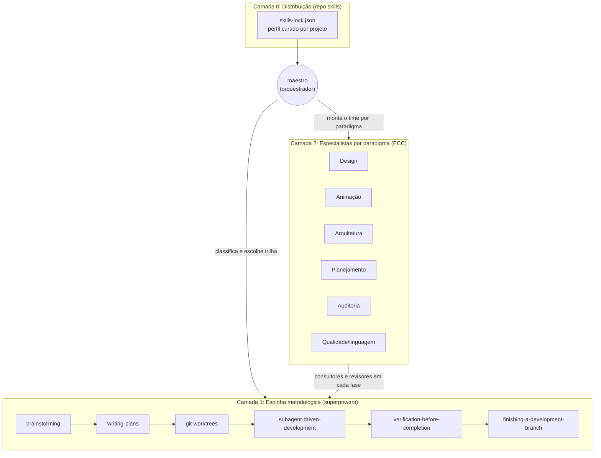

# Proposta: orquestração e fluxo de agentes

Status: **aprovada pelo André em 19/10/2026** (decisões 1 a 5 seguem as recomendações; nome do repositório: ATLAS).
Base analisada: forks `Andre-Atlas/ECC` (v2.2.3, 71 agentes, 311 skills, 97 comandos), `Andre-Atlas/superpowers` (v7.0.0, 15 skills) e `Andre-Atlas/skills` (CLI de distribuição de skills para 79 harnesses).

---

## 1. O que cada repositório já entrega

| Repositório | Papel natural | Peças centrais para orquestração |
|---|---|---|
| **superpowers** | **Metodologia (a espinha dorsal)** | `brainstorming` → `writing-plans` → `using-git-worktrees` → `subagent-driven-development` (implementador novo por tarefa + revisor por tarefa + revisão final) → `requesting/receiving-code-review` → `verification-before-completion` → `finishing-a-development-branch`. Regra "Rulings, not stalls": decide e registra no ledger em vez de parar. |
| **ECC** | **Catálogo de especialistas** | Agentes por papel (`planner`, `architect`, `code-architect`, `tdd-guide`, `code-reviewer`, `security-reviewer`, `a11y-architect`, `performance-optimizer`, revisores por linguagem…), skills por domínio (design, motion, arquitetura, auditoria) e um motor de pipeline: `orch-pipeline` (classificador de tamanho trivial/small/standard/large, 2 gates humanos), `orch-*` (feature, fix, change, refactor, mvp), `workflows/orch-review.workflow.js` (revisão paralela com dedup e verificação adversarial), `team-agent-orchestration` (Kanban de agentes), `council`, `dev-team`, `gan-style-harness`. |
| **skills** | **Distribuição e reprodutibilidade** | `skills add/use/update`, `skills-lock.json` versionado, instalação em `.agents/skills` para Claude Code, Codex, Cursor e outros. Permite instalar só o subconjunto curado, em vez dos 311 skills do ECC. |

### Sobreposições que precisam de um dono único

| Tema | superpowers | ECC | Proposta |
|---|---|---|---|
| Descoberta / spec | `brainstorming` | `planner`, `intent-driven-development`, `product-capability` | superpowers conduz; ECC entra como consultor por paradigma |
| Plano | `writing-plans` | `planner`, `blueprint`, `orch-pipeline` fase 2 | `writing-plans` é o formato canônico; `blueprint` só para projetos multi-sessão |
| TDD | `test-driven-development` | `tdd-guide`, `tdd-workflow` | superpowers como regra; `tdd-guide` como agente executor |
| Execução | `subagent-driven-development` | `orch-*` fase 4, `gan-style-harness` | SDD do superpowers; GAN só para MVP autônomo |
| Revisão | `requesting-code-review` | `code-reviewer`, `orch-review.workflow.js` | `orch-review.workflow.js` (paralelo + dedup + verificação) |
| Verificação | `verification-before-completion` | `verification-loop` | `verification-before-completion` como regra; `verification-loop` como checklist executável |
| Gates humanos | quase nenhum (execução contínua) | 2 gates (plano e commit) | ver Decisão 2 |

---

## 2. Arquitetura proposta: 3 camadas + um maestro

- **Camada 0** garante que cada projeto carrega só o que usa (o ECC inteiro custa contexto demais). O `agent-sort` do ECC gera a lista DAILY vs LIBRARY por repositório; o `skills-lock.json` fixa versões.
- **Camada 1** é o fluxo único, igual para todo paradigma. Ninguém reinventa o ciclo.
- **Camada 2** são "lanes" de especialistas plugadas nas fases do fluxo.
- **maestro** é o único agente novo obrigatório: classifica o pedido, escolhe trilha e tamanho, monta o time e aplica os gates. Nunca implementa.

---

## 3. O maestro: classificação em três eixos

O maestro lê o pedido e declara em uma linha (que o usuário pode corrigir):

1. **Operação** (do `orch-pipeline`): `feature` · `change` · `fix` · `refactor` · `mvp` · e duas novas: `audit` (só diagnóstico, sem código) e `design` (exploração visual antes de código).
2. **Paradigmas envolvidos** (um ou mais): design, animação, arquitetura, planejamento/produto, auditoria/segurança, dados, infraestrutura.
3. **Tamanho** (do `orch-pipeline`): trivial · small · standard · large. Segurança ou contrato público força no mínimo `standard`.

Exemplo de saída:
> `feature · design+animação · standard` → trilha completa, lanes Design e Animação, revisores a11y e performance.

### Fases que rodam por tamanho

| Tamanho | Descoberta | Plano | Execução | Revisão | Verificação | Gates |
|---|---|---|---|---|---|---|
| trivial | — | — | inline | code-reviewer | testes | só o final |
| small | leve | inline | inline (`executing-plans`) | code-reviewer + linguagem | `verification-before-completion` | só o final |
| standard | `brainstorming` | `writing-plans` | SDD | `orch-review.workflow.js` | + lane de auditoria se aplicável | Gate 1 + Gate 2 |
| large | `brainstorming` + `dev-team`/`council` | `writing-plans` (+ `blueprint` se multi-sessão) + ADR | SDD em worktrees paralelas (`team-agent-orchestration`) | workflow + verificador adversarial | + `production-audit` | Gate 1 + Gate 2 |

---

## 4. Fluxo de ponta a ponta

```mermaid
flowchart LR
  I[0. Intake<br/>maestro classifica] --> R[1. Pesquisa e reuso<br/>search-first, skill-scout, code-explorer]
  R --> DS[2. Descoberta<br/>brainstorming + consultores da lane]
  DS --> PL[3. Plano<br/>writing-plans, tarefas tagueadas por lane]
  PL --> G1{{GATE 1<br/>spec + plano}}
  G1 --> EX[4. Execução SDD<br/>implementador por tarefa = especialista da lane]
  EX --> RV[5. Revisão<br/>orch-review: código + linguagem + segurança + revisores da lane]
  RV -->|achados| EX
  RV --> VF[6. Verificação<br/>verification-before-completion + auditoria da lane]
  VF --> G2{{GATE 2<br/>merge / PR}}
  G2 --> LE[7. Aprendizado<br/>continuous-learning-v2, extrair skill se repetir]
```

Regras do fluxo:
- **Entre os gates não se para para perguntar.** Ambiguidades viram "Ruling" no ledger (regra do superpowers). Param só: ação irreversível, ação sensível de segurança, efeito fora da worktree (push, merge, publicação), plano impossível.
- **Cada tarefa do plano carrega uma tag de lane** (`[design]`, `[motion]`, `[arch]`…). O SDD usa a tag para escolher o implementador e o revisor daquela tarefa.
- **Handoff sem estado oculto:** spec, plano, ledger e relatório de revisão são arquivos; qualquer sessão retoma a partir deles.

---

## 5. Lanes por paradigma (o time de cada um)

Cada lane define: quem consulta na descoberta, quem implementa, quem revisa, e qual o critério de pronto.

### Design (UI/UX)
- **Descoberta:** `frontend-design-direction`, `design-system` (extrai tokens e audita consistência), `brand-discovery`
- **Implementa:** agente de linguagem/framework (`react-*`, `vue-*`, `swiftui-patterns`, `liquid-glass-design`) seguindo `make-interfaces-feel-better`
- **Revisa:** `a11y-architect` + `frontend-a11y`, `react-reviewer`/`vue-reviewer`, `click-path-audit`
- **Pronto quando:** tokens respeitados, WCAG 2.2 AA, screenshot de cada estado anexado

### Animação (motion e vídeo)
- **Descoberta:** `motion-foundations` (tokens, springs, reduced-motion) sempre primeiro
- **Implementa:** `motion-patterns`, `motion-advanced`; vídeo com `remotion-video-creation` ou `manim-video`
- **Revisa:** `performance-optimizer` (60 fps, layout thrash, bundle), `a11y-architect` (`prefers-reduced-motion`)
- **Pronto quando:** sem jank no perfil, reduced-motion testado, SSR seguro

### Arquitetura
- **Descoberta:** `architect`, `code-architect`, `code-explorer`; padrões `hexagonal-architecture`, `api-design`, `contract-first`, `backend-patterns`
- **Registra:** `architecture-decision-records` (ADR em `docs/adr/`) para toda escolha estrutural
- **Revisa:** `type-design-analyzer`, `database-reviewer`, `security-reviewer`
- **Pronto quando:** ADR escrito, contrato verificável (OpenAPI/JSON Schema) com teste

### Planejamento / produto
- **Descoberta:** `brainstorming` + `product-capability`, `intent-driven-development` (critérios de aceite verificáveis), `dev-team` para quatro visões (PM, Arq, Dev, QA)
- **Decisões difíceis:** `council` (desacordo estruturado), `santa-method`
- **Saída:** spec + plano; `blueprint` quando o trabalho cruza várias sessões ou PRs; `plan-canvas` para revisão visual do plano

### Auditoria (operação `audit`, sem escrita de código)
- **Time paralelo:** `production-audit`, `security-review`/`security-reviewer`, `silent-failure-hunter`, `performance-optimizer`, `pr-test-analyzer`, `comment-analyzer`; para apps com LLM, `agent-architecture-audit`
- **Consolidação:** mesmo mecanismo do `orch-review.workflow.js` (dedup por evidência + verificador adversarial para CRITICAL/HIGH)
- **Saída:** relatório priorizado; cada achado confirmado vira um item `fix` no backlog

### Qualidade transversal (sempre ligada)
- TDD (`test-driven-development` + `tdd-guide`), `code-reviewer`, revisor da linguagem detectada, `build-error-resolver` quando o build quebra, `security-reviewer` quando o diff toca auth, input, SQL, filesystem, APIs externas, cripto ou segredos.

---

## 6. Agentes novos (mínimo necessário)

Reaproveitar o máximo do ECC. Só criar o que falta para orquestrar:

| Agente | Modelo | Função |
|---|---|---|
| `maestro` | opus | Classifica (operação × paradigma × tamanho), escolhe trilha, monta o time, guarda os gates, mantém o Kanban. Não escreve código. |
| `design-director` | sonnet | Líder da lane Design: aplica direção visual e design system, coordena a11y. |
| `motion-director` | sonnet | Líder da lane Animação: garante motion-foundations antes de qualquer padrão, valida performance e reduced-motion. |
| `audit-lead` | opus | Compõe o time de auditoria, consolida e verifica achados, converte em backlog. |

Arquitetura e planejamento já têm líderes no ECC (`architect`, `planner`), então não ganham agente novo.

**Roteamento de modelo** (padrão do `/model-route` do ECC): opus para maestro, planner, architect, audit-lead e verificador adversarial; sonnet para implementação e revisão; haiku para tarefas mecânicas (renomear, formatar, atualizar docs).

---

## 7. Onde isso vive e como é instalado

Proposta padrão: **um repositório novo de overlay** (`Andre-Atlas/ATLAS`), contendo apenas:
- `agents/` com os 4 agentes novos
- `skills/maestro/` (classificador, mapa de lanes, regras de gate) e `skills/lane-*` (uma por paradigma)
- `profiles/` com listas curadas do ECC por tipo de projeto (web, mobile, backend, vídeo)
- `skills-lock.json` de referência e um script de instalação via CLI `skills`

Motivo: os três repositórios são forks de projetos upstream ativos (o ECC tem 1.333 commits e o superpowers recusa PRs fora do núcleo). Mantê-los intactos permite puxar atualizações do upstream sem conflito; a camada de orquestração fica isolada e versionada.

### Confirmado pelo André (19/10): ECC e superpowers não são editados

- **ECC, superpowers e skills são dependências somente leitura.** Os forks servem só para fixar versões e sincronizar com o upstream; nenhum commit nosso entra neles.
- **O overlay é a infraestrutura.** Ele contém o que é nosso (maestro, líderes de lane, skills de lane, perfis) e aponta para os skills do ECC e do superpowers por nome e versão no `skills-lock.json`.
- **O alvo são os projetos de software.** Em cada projeto, o instalador do overlay roda o CLI `skills` e coloca no repositório: o perfil curado (skills do ECC + superpowers + overlay), os agentes, e um bloco no `CLAUDE.md`/`AGENTS.md` dizendo que o `maestro` conduz o fluxo.
- **Quando um skill de terceiros não serve como está:** criamos no overlay um skill com nome próprio que o envolve ou o substitui, e o perfil passa a instalar o nosso no lugar do original. Nunca editamos o original.
- **Conflitos entre os dois** (ex.: o `using-superpowers` dispara skills automaticamente, o ECC tem gates próprios) são resolvidos por regras de precedência do `maestro` dentro do overlay.

---

## 8. Plano de implantação (após aprovação)

1. **Fundação:** criar o repo overlay, o agente `maestro` e a skill de classificação; perfil curado inicial.
2. **Trilha base:** ligar maestro → superpowers (brainstorm, plan, SDD, finish) + revisão via `orch-review.workflow.js`; validar em um projeto real com uma feature `standard`.
3. **Lanes prioritárias:** Design e Arquitetura e Auditoria (agentes líderes + skills de lane).
4. **Lane Animação** e operação `audit` completa.
5. **Aprendizado:** ativar `continuous-learning-v2` e o ritual de extrair skill quando um padrão repetir 2 vezes; `skill-stocktake` mensal.

Cada etapa tem critério de pronto verificável (uma execução real registrada com ledger e relatório de revisão).

---

## 9. Decisões que dependem do André

| # | Decisão | Opções | Recomendação |
|---|---|---|---|
| 1 | Onde mora a camada de orquestração | **overlay** (repo novo) | ✅ decidido: overlay; ECC e superpowers são somente leitura |
| 2 | Política de gates humanos | **dois** (spec+plano e merge) · um (só merge) · por fase | **dois** |
| 3 | Fonte canônica nas sobreposições | **superpowers** como espinha, ECC como especialista · ECC como espinha | **superpowers** |
| 4 | Harnesses alvo | **Claude Code** só · Claude Code + Codex/Cursor | **Claude Code** primeiro, CLI `skills` deixa a porta aberta |
| 5 | Ordem das lanes | **Design + Arquitetura + Auditoria** primeiro · outra ordem | **Design + Arquitetura + Auditoria** |
| 6 | Projeto piloto | qual repositório de software real valida o fluxo | André indica |
